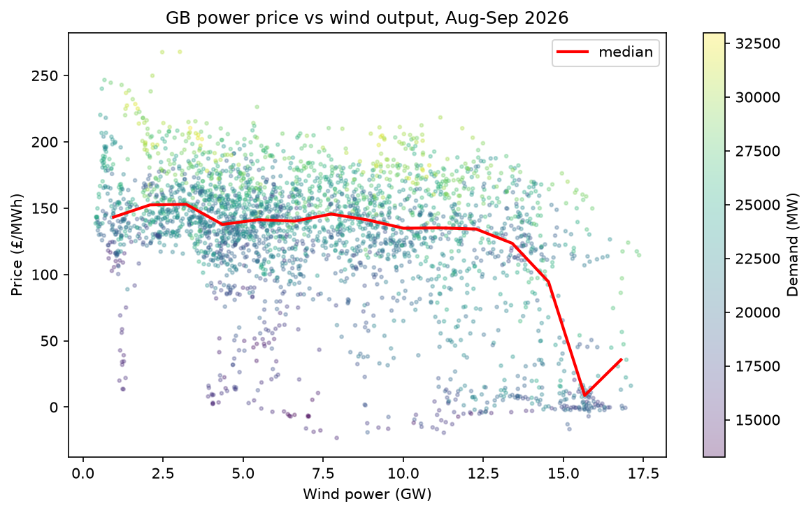
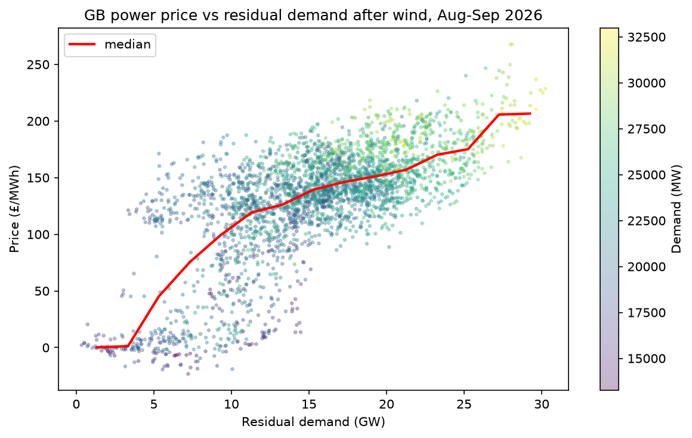
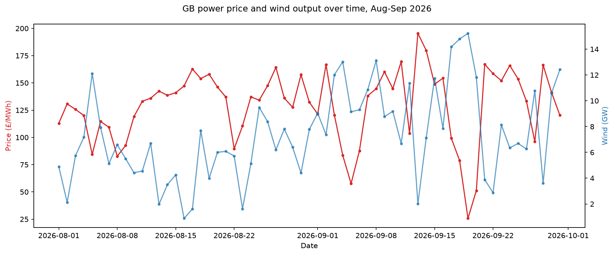

# gb-wind-power-price

Investigating how wind affects the power price in Great Britain, using half-hourly data from Elexon for August and September 2026.

## Summary

In summary, wind does affect the power price in Great Britain, but in a non-trivial way. Most of the time a gas plant is the most expensive generator needed to meet demand, so gas sets the price, and extra wind just replaces one gas plant with another of similar cost. When wind becomes very high (above about 13 GW), gas is no longer needed at the margin and the price plummets, sometimes going negative.

What actually explains the price is the demand left over after wind (residual demand), which tracks the price much more closely than wind on its own. The highest price spikes all happened in the evening peak, when wind was low and demand was high.

## Data

I pulled three series from Elexon's Insights API: the Market Index price (MID), wind generation (FUELHH, wind only) and national demand (INDO). After merging there are 2,925 half-hours covering 1 August to 30 September 2026. The API only allows 7 days per request, so the data is fetched in weekly chunks and cached to CSV.

Two providers report MID prices and one of them often reports zero volume, so I volume-weighted the prices across providers to give a more representative price for each half-hour.

Three periods (overnight on 11 September) had no trades, so they were dropped.

The wind data only includes transmission-connected wind. Smaller wind farms connected to the distribution network ("embedded" wind) aren't included, so this underestimates total GB wind.

The demand used was INDO, which is measured at transmission level, so embedded wind and solar show up as lower demand rather than as generation.

All times are aligned on UTC start time for consistency, which also deals with the clock changes. For time-of-day features I converted to UK time, since demand follows clock time.

## Results

### Plot 1: price vs wind



I expected a fairly consistent drop in price as wind increased. However, I found the median price was very flat (around £135–150/MWh) for wind up to around 12–13 GW, and then dropped sharply to a median of around £10/MWh, with some negative prices. In the flat part, gas is setting the price. At very high wind, gas is pushed off the margin and the price is set by generators willing to sell for almost nothing; some subsidised renewables will even pay to keep generating.

### Plot 2: price vs residual demand



This plots price against residual demand (demand minus wind). I expected it to have a similar spread to plot 1, just flipped. However, residual demand ranked with price much more strongly (Spearman 0.66, compared with −0.31 for wind alone), and the median line traces out the merit order: near £0 at low residual demand, a steep rise as gas starts setting the price, a gentle slope through the gas plants, then a steeper rise again above about 25 GW when the most expensive plants are needed.

### Plot 3: daily price and wind over time



This shows a few periods with a clear inverse relation between price and wind, but it's quite messy overall. The clearest examples are a calm spell in mid-August, when the price climbed to around £160/MWh, and the windiest stretch (17–20 September, 14–15 GW), which had the lowest daily average price, around £25/MWh. Daily averages hide the intraday spikes, so I looked at those separately.

## Regression

I tested three models. All of them use HAC (Newey–West, 48 lags) standard errors, because the residuals are strongly autocorrelated (Durbin–Watson about 0.06). I checked how much this matters: for model 1, the naive OLS standard error on wind was 0.21, against 1.04 with HAC, so the naive one is about 5 times too small. Roughly speaking, the 2,925 half-hours carry about as much information as 120 independent observations.

| Model | Wind (£/MWh per GW) | Demand (£/MWh per GW) | R² |
|---|---|---|---|
| m1: price ~ wind | −4.9 (95% CI −6.9 to −2.9) | – | 0.16 |
| m2: price ~ wind + demand + hour | −4.9 (−6.4 to −3.5) | +10.1 (+8.4 to +11.9) | 0.66 |
| m3: price ~ residual + residual² + hour | – | – | 0.65 |

Model 1: each extra gigawatt of wind lowers the price by about £5/MWh on average, but wind alone only explains about a sixth of the variation in price, which matches the loose scatter in plot 1.

Model 2: adding demand and time of day takes R² from 0.16 to 0.66. The wind coefficient stays the same, so leaving out demand wasn't biasing the wind estimate, it was just leaving a lot unexplained. Each extra gigawatt of demand raises the price by about £10/MWh.

If price only depended on residual demand, the wind and demand coefficients would be equal and opposite. I tested this (wind + demand = 0) and got +5.2 £/MWh per GW (95% CI 3.3 to 7.1, p < 0.001), so the demand effect is larger than the wind effect. I think there are a few possible reasons: the real relationship isn't linear, so a single wind coefficient averages the flat part and the steep part; demand may be picking up things I haven't included, like solar; and gas prices changed over the two months.

Model 3: this uses residual demand and its square. The R² of 0.65 is close to model 2's, even though it's less flexible (it forces wind and demand to have equal and opposite effects, which the test above rejected). The squared term is negative, so the curve flattens: the slope goes from about £10.6/MWh per GW at 5 GW of residual demand to about £1.8 at 25 GW. The downside is that the parabola peaks at about 29 GW, so it predicts prices starting to fall at the highest demand values. That means it misses the scarcity end, which is exactly where the spikes are.

Holding wind and demand fixed, prices are about £30–37/MWh lower around late morning and midday, which could be solar, but I haven't included solar data to check.

## Price spikes

I also looked at the highest price spikes, defined as the top 1% of half-hourly prices (£214/MWh or more, 30 half-hours).

| Median | All periods | Spikes |
|---|---|---|
| Price (£/MWh) | 139 | 225 |
| Wind (GW) | 6.6 | 1.7 |
| Demand (GW) | 22.3 | 29.3 |
| Residual demand (GW) | 15.6 | 27.5 |
| Traded volume (MWh) | 2,703 | 3,996 |

All 30 spikes fall between 15:00 and 20:00 UK time, with 25 of them between 17:00 and 19:00. That's the evening peak, which makes sense: people come home, demand is highest, and solar has dropped off.

They also happen when wind is low (1.7 GW median vs 6.6 GW) and demand is high (29.3 GW vs 22.3 GW). The median spike sits at the 99th percentile of residual demand, so they happen at the very top of the merit order, when the most expensive plants are needed.

Traded volume is also higher during spikes, which rules out the idea that they're just noise from thinly traded half-hours.

One caveat is that the 30 spikes fell on only 8 days, so it's really 8 events rather than 30 independent ones.

## Problems I ran into

- The API rejects requests longer than 7 days, so I had to write a chunked fetch and remove duplicate rows where chunks overlap.
- Some MID rows have zero price and zero volume, and sometimes both providers report real trades in the same half-hour. Picking one row would have been arbitrary, which is why I volume-weighted.
- 25 October (the clocks going back) has 50 settlement periods, and settlement dates follow UK time. Indexing everything on UTC start time avoided this causing problems.
- Some endpoints silently ignore parameters in the wrong format and return today's data instead of an error, so I checked the date range of every fetch.

## Limitations

I've only used two months of data (late summer into autumn), so the results might not hold in winter. I haven't included gas or carbon prices, solar, nuclear availability or interconnector flows. The wind data excludes embedded generation, and the models can't capture the scarcity end of the curve.

## What I'd do next

- Add gas prices, to see how much of the price level and the leftover variation they explain.
- Add solar to residual demand and check whether the midday effect goes away.
- Use a longer period including winter.
- Try a piecewise or spline model to capture the shape of the merit order properly.
- Run a block permutation test (shuffling whole days) on the spike comparison.

## How to run

```bash
uv sync
```

Then open `analysis.ipynb` and run all cells. It reads the cached data in `data/`. Set `REFRESH = True` in the load cell to re-download from the Elexon API (no API key needed).
